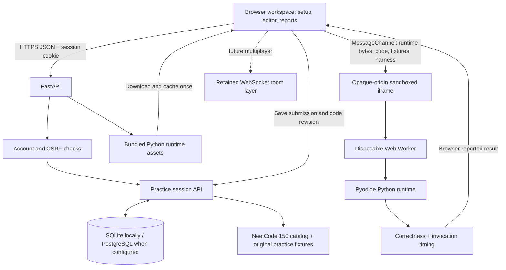
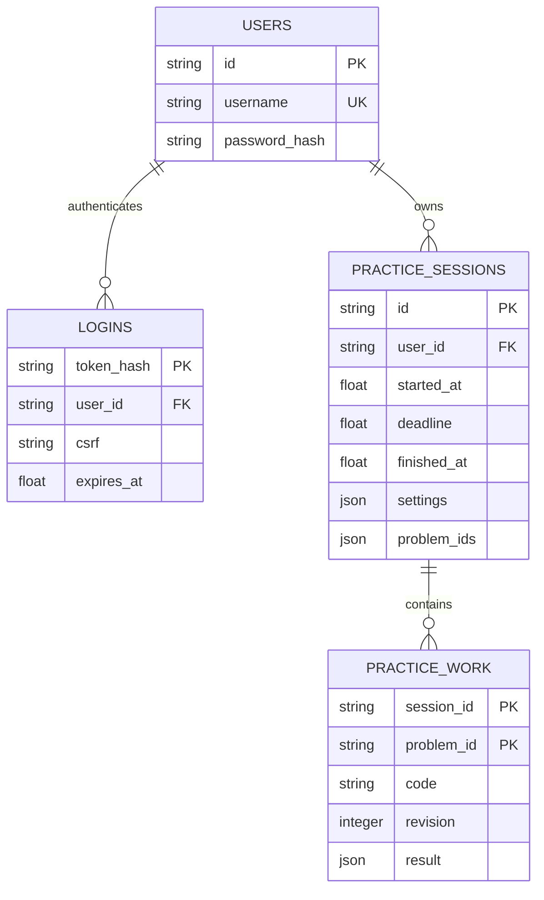

# Pair — interview practice architecture and ownership

Updated November 24, 2026. This implementation is delivered on the `tyler` branch of [tylerkngyn/tylerjunze](https://github.com/tylerkngyn/tylerjunze/tree/tyler). The practice workspace was built from baseline `9229191` and integrated with `tyler` at `70fd5fa`, preserving its chat, typing indicators, and reactions. GitHub `main` at `16dc9b0` contains additional Redis room infrastructure that is not integrated into this branch. A GitHub push does not establish the state of the live Render deployment.

## Product scope

Pair is now a single-player, timed Python interview practice workspace. Users create a username/password account, choose NeetCode 150 topics and difficulty, select or randomize 1–5 problems, and set a 5–180 minute time budget. Overtime is optional and enabled by default. The default is one problem in 45 minutes.

The workspace includes a lightweight code editor, example execution, full practice-suite submission, account-scoped draft saving, session history, correctness results, and device-local efficiency comparisons. Two-player interviews, AI feedback, speech, explanations/readability scoring, and server-verified assessments are future work.

The former word/image association prototype and its model, assets, data, tooling dependency file, and tests have been removed. The chat foundation is retained at `/chat` and `/ws` for future paired interviews.

## Implemented architecture

FastAPI handles accounts, ownership, problem selection, session deadlines, draft versions, and result persistence. It does not execute submitted code. Execution is confined to the user's browser. This avoids operating a paid execution service and keeps CPU-bound user code out of the web-server process.

The workspace fetches five bundled Pyodide core files (about 13 MB) from FastAPI, displays byte progress, and caches their buffers for subsequent runs. Versioned static URLs have immutable HTTP-cache headers for reuse after refresh. No external runtime CDN is needed. The original direct-CDN loader stalled on slow connections and was replaced on November 24.

The iframe uses `sandbox="allow-scripts"` without `allow-same-origin`. Its worker therefore has an opaque origin. A restricted Content Security Policy denies all real network connections (`connect-src 'none'`). Module imports use blob URLs and runtime fetches resolve only against the supplied in-memory file bundle. No account cookie or CSRF token is passed to the runner. Communication uses a dedicated MessageChannel after verifying the iframe window and its opaque origin. This loading path is verified in Chrome with external HTTP requests blocked.

Each run gets a fresh worker while retaining reusable runtime bytes in the workspace. Stop and a 10-second execution timeout terminate it. Downloading has a 90-second timeout, iframe startup has a 10-second timeout, and interpreter initialization has a 30-second timeout. Stop also cancels asset downloads, failed downloads release controls for retry, and unhandled worker promise errors are surfaced. API/harness requests have 20-second timeouts. These limits keep the parent workspace responsive during an infinite loop. There is no hard browser-memory limit.

A real Chrome profile retained the old 1.9 KB CDN-based runner in its iframe disk cache even after the workspace had updated to the bundled loader. Network inspection confirmed that it downloaded the new local assets but launched the cached old runner, causing the remaining timeout. Startup scripts and the iframe now use `rev=bundled-v2` URLs and a matching handshake. Legacy/mismatched runners fail immediately with a refresh message. This was verified in the user's existing Chrome tab: Run completed and displayed the starter code's expected `NotImplementedError` rather than hanging. A regression check injects a stale runner and confirms rejection and successful retry.

## Component and file map

| Component | Files | Responsibility |
| --- | --- | --- |
| HTTP composition | `app/main.py` | Lifecycle, static files, API router, security headers, retained chat routes. |
| Accounts | `app/practice/auth.py` | Registration/login/logout, password hashes, login-cookie sessions, CSRF/origin checks, attempt limits. |
| Durable storage | `app/practice/database.py` | SQLAlchemy models and SQLite/PostgreSQL initialization. |
| Practice orchestration | `app/practice/routes.py` | Selection validation, ownership, deadlines, draft revisions, results, history. |
| Problem metadata | `app/practice/catalog.json`, `catalog.py` | 150 entries with categories, difficulties, starter interfaces, pinned reference implementations. |
| Practice content | `app/practice/exercises.py` | Original prompts, explicit expected outputs, larger deterministic cases, adapter/comparator choices. |
| Workspace | `static/index.html`, `static/practice/app.js`, `styles.css` | Minimal grayscale UI, filtering, editor, timer, autosave, execution, results, history. |
| Isolated execution | `static/practice/runner.html`, `harness.py` | Worker lifecycle, Python loading, function/design-class adapters, judging and timing. |
| Runtime delivery | `static/practice/runtime-loader.js`, `runtime/314.0.8/**` | App-hosted core assets, byte progress, memory/HTTP cache, manifest, license/source notices. |
| Retained chat | `static/chat.html`, `app/room_manager.py`, `app/models.py` | Existing two-person room protocol and local socket lifecycle. |
| Tooling | `tools/import_neetcode.py`, `tools/browser_smoke.py` | Explicit catalog refresh and real-browser verification. |
| Deployment | `requirements.txt`, `render.yaml`, `.env.example` | Python dependencies, single free web instance, documented database settings. |

The editor intentionally stays lightweight: textarea-based with line numbers, indentation, and keyboard execution. There is no frontend framework, build pipeline, autocomplete service, or package-install console.

## Data and trust boundaries

`auth_limits` stores atomic per-address/per-username counters with expiry windows. Passwords use salted scrypt. Login tokens are random, stored only as SHA-256 hashes, and issued through HttpOnly, SameSite=Strict cookies. HTTPS hosting uses Secure cookies. Logins expire after seven days and logout revokes the database token. Writes require the session's CSRF token and pass request-origin checks. Private API responses disable caching.

Accounts use usernames rather than email; email verification, password reset, account deletion, and account migration between databases have not been implemented. Persistent storage is now authorized by the account requirement and replaces the original chat-only no-database constraint.

Server-owned facts: user identity, ownership, selected problems, deadline, lifecycle, draft revision, stored code, and score arithmetic. Browser-reported facts: test outcomes and execution measurements. A user can inspect test data and alter browser reports. This is personal practice, not an anti-cheating judge. Schema/count validation does not convert a browser report into server-verified execution.

## Request flow

1. Register or sign in through `/api/auth/register` or `/api/auth/login`; receive the login cookie plus a CSRF token.
2. Fetch catalog metadata from `/api/catalog`; configure a session locally.
3. `POST /api/practice` validates category/difficulty, distinct selected IDs, count, and duration. The server creates a session, one draft per problem, and its deadline.
4. `GET /api/practice/{id}` restores account-owned work. `GET /api/problems/{problem_id}` supplies the prompt, starter, practice fixtures, and reference to the signed-in browser.
5. Editor changes save locally and debounce a `PUT /api/practice/{id}/work/{problem_id}`. A revision precondition rejects stale updates with 409. Editing code invalidates the previous result.
6. Run checks the first two fixtures without persisting a score. Submit checks the full practice suite and sends the result with the exact code snapshot. Code is stored as text and never executed by the API.
7. Overtime sessions remain editable past the deadline. Strict sessions become expired; editing and new writes stop. There is no automatic final submission. Finish records completion and shows the report.
8. `GET /api/practice` lists the latest 30 sessions for that account. Another account gets 404 for someone else's session ID.

## Correctness and efficiency

All 150 catalog entries have runnable practice suites, totaling 460 fixtures. Prompts and fixtures were authored for this application; private LeetCode statements/tests were not imported. Metadata and reference code are MIT-licensed upstream material pinned to commit `2736633bf3d8a81115b10f299306be91cf822f39`; attribution and the full license are included.

Adapters handle normal functions, stateful design classes, linked lists, random-pointer deep copies, trees, graph deep copies, in-place outputs, and encode/decode round-trips. Output comparators accept relevant alternatives rather than requiring one arbitrary ordering. A bounded stdout/stderr capture shows print output and exceptions.

Correctness is passed tests divided by all fixture tests for the session; unsubmitted problems contribute zero. This measures the supplied suite, not exhaustive correctness or enforcement of every complexity restriction in a prompt. Future content work should increase adversarial/property tests and stronger constraint checks.

Efficiency is reported separately after all tests pass. Three batches per fixture produce a median invocation time, normalized per call; fixture medians are summed for a suite measurement. A reference implementation is measured on the same inputs and device. Fixture construction, compilation, runtime download, and output serialization are outside timing; object construction and invocation-loop overhead are included. Very small measurements are labeled unsuitable for a stable ratio. Reference implementations are baselines, not guaranteed optimal solutions. No Big-O inference, memory profiler, user percentile, or artificial combined efficiency grade is claimed.

## Free deployment

Local development uses ignored `var/pair.db` with no external service. Set `DATABASE_URL` to use PostgreSQL through psycopg instead. Initial tables are created under a startup lock; future schema evolution requires migrations.

The Render manifest declares one free web instance, secure cookies, and `/health`. It does not provision PostgreSQL. Free Render local files, including SQLite, are ephemeral across restarts/redeploys/spin-down. Before relying on hosted accounts, create a free PostgreSQL database (for example Neon Free, within its quotas), then configure `DATABASE_URL` and the exact HTTPS `PUBLIC_ORIGIN` in Render. This work does not create a cloud database or change the live deployment.

References: [Render free filesystem behavior](https://render.com/docs/free), [Neon Free plan](https://neon.com/pricing), [Pyodide runtime](https://pyodide.org/en/stable/usage/webworker.html), [NeetCode source](https://github.com/neetcode-gh/leetcode).

## Two-person delivery plan

Use one owner per file. The following is the proposed ongoing split, not a claim that two people or agents implemented this change.

| Owner | Owns | First follow-up work |
| --- | --- | --- |
| Tyler — practice experience and content | `static/index.html`, `static/practice/**`, `app/practice/exercises.py`, `catalog.py`, `catalog.json`, `NEETCODE_LICENSE.txt`, `tools/import_neetcode.py`, `tools/browser_smoke.py`, content/harness tests | Better editor interactions, richer prompts/fixtures, benchmark quality, report UX, accessibility. |
| Junze — accounts, persistence, transport, deployment | `app/main.py`, `app/practice/auth.py`, `database.py`, `routes.py`, retained `app/models.py`/`room_manager.py`, `static/chat.html`, requirements, Render/env configuration, API/security/chat tests | Live PostgreSQL verification, migrations, recovery/account lifecycle, deployment configuration, Redis room integration and future multiplayer authorization. |
| Junze as documentation integrator; Tyler supplies content changes | `README.md`, `docs/architecture.md`, this Obsidian note | Keep the implemented/deployed distinction and ownership map current. |

Move future harness/content tests into separate owner-specific files rather than editing one shared test module concurrently. The current combined `tests/practice/test_practice.py` is handed to Junze for API tests; Tyler should add content/harness tests in a new module when starting parallel work.

Before parallel feature work, agree on Pydantic request/response schemas in `routes.py` and example JSON. Junze owns edits to shared API definitions; Tyler consumes that contract. Backend changes should preserve compatibility or land before the dependent frontend change. Do not have both developers edit `app/main.py`, requirements, or the same migration. Use separate feature branches and small PRs; one migration owner/sequence prevents database conflicts.

## Multiplayer extension

Keep practice rules and execution independent of room storage. A later paired interview room should reference a persisted practice-session ID and explicit participant roles, not infer a leader from an unordered Redis hash. PostgreSQL remains the durable source for accounts, drafts, and reports. Redis can hold live membership/presence and deliver room events to each worker's local sockets.

Integrate the existing GitHub Redis implementation deliberately before scaling chat workers. Redis Pub/Sub is live delivery without durable replay; do not use it as the only store for submissions or grades. Shared editing needs a conflict strategy beyond whole-draft last-writer updates. A trusted multiplayer assessment also needs a separate server-side execution service; current browser scores remain self-reported.

## Verification and remaining work

The automated suite passes 197 tests covering the 150 reference implementations and starter failures, alternative outputs/deep-copy checks, account hashing/cookies/revocation/CSRF/limits, ownership isolation, stale revisions, score invalidation, configuration, deadlines/overtime, restart persistence, execution boundaries, bundled asset delivery, and retained chat lifecycle. With all external HTTP requests blocked, the real-browser workflow passes account creation/login/history, Run/Submit, runtime reuse, themes, mobile layout, opaque-origin isolation, Stop, and automatic execution timeout. Injected missing-asset and stalled-download checks also pass: controls recover, Stop cancels loading, and retry succeeds. The extended browser run passes every reference across all 150 problems and 460 fixtures using the app's real bundled files, without a test-only CDN replacement.

No live PostgreSQL deployment, Render configuration change, cloud provisioning, multiplayer interview, or trusted judge is claimed. See the repository README for commands and exact execution limitations.
