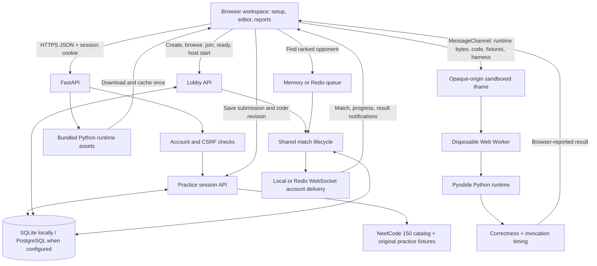
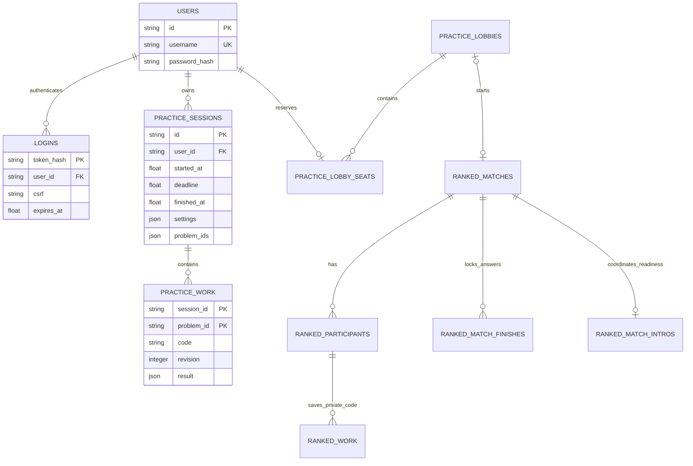
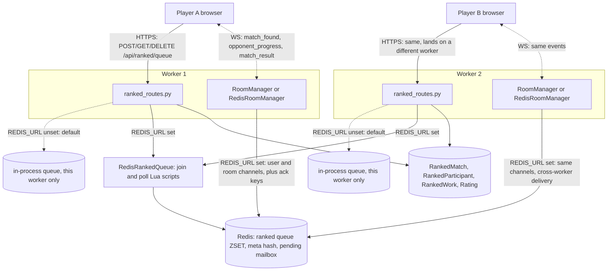

# Pair — interview practice architecture and ownership

Updated November 24, 2026. The `tyler` implementation builds on merged `main` at `93b198f`, including Redis transport and ranked matchmaking. This delivery adds public/private lobbies, the ranked product flow, shared lobby/ranked countdowns, unique online presence, and persistent cross-topic problem selection. The changes are recorded locally on `tyler`; no GitHub push or Render deployment is performed by this delivery.

## Product scope

Pair supports timed solo Python practice, public two-player unranked lobbies with room codes, and ranked matchmaking. Users create a username/password account, choose NeetCode 150 topics and difficulty, select or randomize 1–5 problems, and set a 5–180 minute time budget. Solo overtime is optional and enabled by default. Multiplayer uses randomized problems and strict deadlines. The UI default is one problem in 45 minutes.

The shared workspace includes a lightweight code editor, example execution, full practice-suite submission, private account-scoped drafts, history, correctness results, device-local efficiency comparisons, and aggregate opponent progress. AI feedback, speech, shared editing, explanations/readability scoring, and server-verified assessments are future work.

The former word/image association prototype and its model, assets, data, tooling dependency file, and tests have been removed. Legacy chat is retained at `/chat`; `/ws` also carries authenticated match notifications.

## Implemented architecture



FastAPI handles accounts, ownership, problem selection, session deadlines, draft versions, and result persistence. It does not execute submitted code. Execution is confined to the user's browser. This avoids operating a paid execution service and keeps CPU-bound user code out of the web-server process.

The workspace fetches five bundled Pyodide core files (about 13 MB) from FastAPI, displays byte progress, and caches their buffers for subsequent runs. Versioned static URLs have immutable HTTP-cache headers for reuse after refresh. No external runtime CDN is needed. The original direct-CDN loader stalled on slow connections and was replaced on November 24.

The iframe uses `sandbox="allow-scripts"` without `allow-same-origin`. Its worker therefore has an opaque origin. A restricted Content Security Policy denies all real network connections (`connect-src 'none'`). Module imports use blob URLs and runtime fetches resolve only against the supplied in-memory file bundle. No account cookie or CSRF token is passed to the runner. Communication uses a dedicated MessageChannel after verifying the iframe window and its opaque origin. This loading path is verified in Chrome with external HTTP requests blocked.

Each run gets a fresh worker while retaining reusable runtime bytes in the workspace. Stop and a 10-second execution timeout terminate it. Downloading has a 90-second timeout, iframe startup has a 10-second timeout, and interpreter initialization has a 30-second timeout. Stop also cancels asset downloads, failed downloads release controls for retry, and unhandled worker promise errors are surfaced. API/harness requests have 20-second timeouts. These limits keep the parent workspace responsive during an infinite loop. There is no hard browser-memory limit.

A real Chrome profile retained the old 1.9 KB CDN-based runner in its iframe disk cache even after the workspace had updated to the bundled loader. Network inspection confirmed that it downloaded the new local assets but launched the cached old runner, causing the remaining timeout. Startup scripts and the iframe now use `rev=bundled-v2` URLs and a matching handshake. Legacy/mismatched runners fail immediately with a refresh message. This was verified in the user's existing Chrome tab: Run completed and displayed the starter code's expected `NotImplementedError` rather than hanging. A regression check injects a stale runner and confirms rejection and successful retry.

## Component and file map

| Component | Files | Responsibility |
| --- | --- | --- |
| HTTP composition | `app/main.py` | Lifecycle, static files, API router, security headers, retained chat routes. |
| Accounts | `app/practice/auth.py` | Registration/login/logout, password hashes, login-cookie sessions, CSRF/origin checks, attempt limits. |
| Durable storage | `app/practice/database.py`, `migrations.py` | SQLAlchemy models, SQLite/PostgreSQL initialization, idempotent upgrades under the startup schema lock. |
| Practice orchestration | `app/practice/routes.py` | Selection validation, ownership, deadlines, draft revisions, results, history. |
| Lobbies | `app/practice/lobby_routes.py` | Public list, six-character codes, two seats, readiness, host start, waiting-seat leases. |
| Match orchestration | `app/practice/ranked_routes.py`, `ranked.py` | Queue endpoints, private participant work, match recovery, finish/forfeit, correctness/time outcomes, ranked Elo. |
| Distributed queue | `app/practice/redis_ranked_queue.py` | Atomic Lua pairing, pending mailboxes, queue sweep, finalization lock. |
| Problem metadata | `app/practice/catalog.json`, `catalog.py` | 150 entries with categories, difficulties, starter interfaces, pinned reference implementations. |
| Practice content | `app/practice/exercises.py` | Original prompts, explicit expected outputs, larger deterministic cases, adapter/comparator choices. |
| Workspace | `static/index.html`, `static/practice/app.js`, `problem-map.js`, `multiplayer.js`, `styles.css` | Topic/problem node map, unique online counter, public/private lobby/search/loading views, shared editor/runner, results/history, bottom footer. |
| Isolated execution | `static/practice/runner.html`, `harness.py` | Worker lifecycle, Python loading, function/design-class adapters, judging and timing. |
| Runtime delivery | `static/practice/runtime-loader.js`, `runtime/314.0.8/**` | App-hosted core assets, byte progress, memory/HTTP cache, manifest, license/source notices. |
| Live transport | `app/room_manager.py`, `app/redis_room_manager.py`, `app/models.py`, `static/chat.html` | Account match notifications and retained two-person chat protocol. |
| Tooling | `tools/import_neetcode.py`, `tools/browser_smoke.py`, `tools/browser_multiplayer_smoke.py` | Explicit catalog refresh, solo and two-account real-browser verification. |
| Deployment | `requirements.txt`, `render.yaml`, `.env.example` | Python dependencies, single free web instance, documented database settings. |

The editor intentionally stays lightweight: textarea-based with line numbers, indentation, and keyboard execution. There is no frontend framework, build pipeline, autocomplete service, or package-install console.

## Data and trust boundaries



`auth_limits` stores atomic per-address/per-username counters with expiry windows. Passwords use salted scrypt. Login tokens are random, stored only as SHA-256 hashes, and issued through HttpOnly, SameSite=Strict cookies. HTTPS hosting uses Secure cookies. Logins expire after seven days and logout revokes the database token. Writes require the session's CSRF token and pass request-origin checks. Private API responses disable caching.

Accounts use usernames rather than email; email verification, password reset, account deletion, and account migration between databases have not been implemented. Persistent storage is now authorized by the account requirement and replaces the original chat-only no-database constraint.

Server-owned facts: user identity, ownership, selected problems, deadline, lobby seats/readiness, match lifecycle, draft revision, stored code, and score arithmetic. Browser-reported facts: test outcomes and execution measurements. A user can inspect test data and alter browser reports. Ranked ratings are practice ratings, not trusted assessments. Schema/count validation and the ranked ten-second submission floor do not establish genuine execution. Device-local runtime comparisons are displayed separately and do not decide ranked outcomes.

## Request flow

1. Register or sign in through `/api/auth/register` or `/api/auth/login`; receive the login cookie plus a CSRF token.
2. Fetch catalog metadata from `/api/catalog`; configure a session locally.
3. `POST /api/practice` validates category/difficulty, distinct selected IDs, count, and duration. The server creates a session, one draft per problem, and its deadline.
4. `GET /api/practice/{id}` restores account-owned work. `GET /api/problems/{problem_id}` supplies the prompt, starter, practice fixtures, and reference to the signed-in browser.
5. Editor changes save locally and debounce a `PUT /api/practice/{id}/work/{problem_id}`. A revision precondition rejects stale updates with 409. Editing code invalidates the previous result.
6. Run checks the first two fixtures without persisting a score. Submit checks the full practice suite and sends the result with the exact code snapshot. Code is stored as text and never executed by the API.
7. Overtime sessions remain editable past the deadline. Strict sessions become expired; editing and new writes stop. There is no automatic final submission. Finish records completion and shows the report.
8. `GET /api/practice` lists the latest 30 sessions for that account. Another account gets 404 for someone else's session ID.

## Correctness and efficiency

All 150 catalog entries have runnable practice suites, totaling 460 fixtures. Prompts and fixtures were authored for this application; private LeetCode statements/tests were not imported. Metadata and reference code are MIT-licensed upstream material pinned to commit `2736633bf3d8a81115b10f299306be91cf822f39`; attribution and the full license are included.

Adapters handle normal functions, stateful design classes, linked lists, random-pointer deep copies, trees, graph deep copies, in-place outputs, and encode/decode round-trips. Output comparators accept relevant alternatives rather than requiring one arbitrary ordering. A bounded stdout/stderr capture shows print output and exceptions.

Correctness is passed tests divided by all fixture tests for the session; unsubmitted problems contribute zero. This measures the supplied suite, not exhaustive correctness or enforcement of every complexity restriction in a prompt. Future content work should increase adversarial/property tests and stronger constraint checks.

Efficiency is reported separately after all tests pass. Three batches per fixture produce a median invocation time, normalized per call; fixture medians are summed for a suite measurement. A reference implementation is measured on the same inputs and device. Fixture construction, compilation, runtime download, and output serialization are outside timing; object construction and invocation-loop overhead are included. Very small measurements are labeled unsuitable for a stable ratio. Reference implementations are baselines, not guaranteed optimal solutions. No Big-O inference, memory profiler, user percentile, or artificial combined efficiency grade is claimed.

## Free deployment

Local development uses ignored `var/pair.db` with no external service. Set `DATABASE_URL` to use PostgreSQL through psycopg instead. Initial tables are created under a startup lock; future schema evolution requires migrations.

The Render manifest declares one free web instance, secure cookies, and `/health`. It does not provision PostgreSQL. Free Render local files, including SQLite, are ephemeral across restarts/redeploys/spin-down. Before relying on hosted accounts, create a free PostgreSQL database (for example Neon Free, within its quotas), then configure `DATABASE_URL` and the exact HTTPS `PUBLIC_ORIGIN` in Render. This work does not create a cloud database or change the live deployment.

References: [Render free filesystem behavior](https://render.com/docs/free), [Neon Free plan](https://neon.com/pricing), [Pyodide runtime](https://pyodide.org/en/stable/usage/webworker.html), [NeetCode source](https://github.com/neetcode-gh/leetcode).

## Two-person delivery plan

Use one owner per file. The following is the proposed ongoing split, not a claim that two people or agents implemented this change.

| Owner | Owns | First follow-up work |
| --- | --- | --- |
| Tyler — practice experience and content | `static/index.html`, `static/practice/**` including `multiplayer.js`, `app/practice/exercises.py`, `catalog.py`, `catalog.json`, `NEETCODE_LICENSE.txt`, `tools/import_neetcode.py`, both browser smoke scripts, content/harness tests | Editor interactions, lobby/match UX, richer fixtures, benchmark quality, report UX, accessibility. |
| Junze — accounts, persistence, transport, deployment | `app/main.py`, `app/practice/auth.py`, `database.py`, `migrations.py`, `routes.py`, `lobby_routes.py`, `ranked_routes.py`, `ranked.py`, `redis_ranked_queue.py`, `app/models.py`, both room managers, `static/chat.html`, requirements, Render/env configuration, API/security/transport tests | Live PostgreSQL verification, migrations, account lifecycle, queue/match atomicity, deployment configuration, Redis operational testing. |
| Junze as documentation integrator; Tyler supplies content changes | `README.md`, `docs/architecture.md`, this Obsidian note | Keep the implemented/deployed distinction and ownership map current. |

Move future harness/content tests into separate owner-specific files rather than editing one shared test module concurrently. The current combined `tests/practice/test_practice.py` is handed to Junze for API tests; Tyler should add content/harness tests in a new module when starting parallel work.

Before parallel feature work, agree on Pydantic request/response schemas in `routes.py` and example JSON. Junze owns edits to shared API definitions; Tyler consumes that contract. Backend changes should preserve compatibility or land before the dependent frontend change. Do not have both developers edit `app/main.py`, requirements, or the same migration. Use separate feature branches and small PRs; one migration owner/sequence prevents database conflicts.

## Public lobbies and the product frontend — implemented

The setup UI switches between solo practice and Play together. Public open lobbies and room-code entry share the right-hand panel; new lobbies and ranked searches use the settings panel. Joining a lobby uses the host's settings. Layout width is centered and bounded, difficulty/timer/results use muted accents, transitions honor reduced motion, and a flex page shell keeps the attribution footer at the bottom of short views without covering long content.

The solo picker is a topic map. Choosing a topic (by node or dropdown) opens selectable problem nodes. Search filters problem nodes; selections update the configured count. One persistent selection set spans topic, search, and difficulty changes; a removable basket exposes the whole selection and topic nodes show selected counts. Only Random or explicit removal clears selections. Starting an explicit selection derives the request's category union and difficulty from the chosen IDs, so the API's existing filter validation accepts mixed categories/difficulties even when browsing a single topic. HTML buttons provide keyboard selection and `aria-pressed` state, with SVG category-membership edges behind them. Edges do not imply prerequisites. `problem-map.js` owns layout and selection rendering. Explanatory UI paragraphs have been removed; labels, problem content, run/save/connection states, and actionable errors remain.

`Lobby` persists the host, optional guest, settings, ready flags, status, privacy flag, and resulting match ID. Creation accepts `is_private` (strict boolean, default false); the flag is returned separately from match filters. Public listing excludes private rows server-side. Private lobbies use the same member-only detail endpoints and can be joined by someone who knows the code. `LobbySeat` reserves one lobby per account and records heartbeat time. Conditional SQL updates claim the guest seat, change readiness, start once, and release seats. Both players must be ready and only the host can start; the host starts ready. Waiting seats expire after 120 seconds without polling: a missing host closes the lobby, while a missing guest frees the seat and clears readiness. Closed/full lobbies disappear from the public list. These are database-coordinated operations, independent of WebSocket worker affinity.

`GET /api/presence` returns `{"online": <count>}` to signed-in callers. Counts are unique authenticated accounts with active WebSockets; anonymous sockets are excluded and extra tabs are deduplicated. The local manager tracks all identified peers separately from its latest-socket delivery target. Redis stores one `user_id:peer_id` member per connection in the `online_users` sorted set, renews its score on the existing heartbeat (even without a room), and removes it on disconnect. Count reads atomically prune scores older than the presence lease (90 seconds by default) and deduplicate account IDs across workers. A crashed worker's connections therefore age out. The header polls roughly every five seconds and uses a green dot, or an unavailable indicator if a fetch fails.

| Endpoint | Purpose |
| --- | --- |
| `GET /api/lobbies` | Latest 30 public waiting lobbies with an open seat. |
| `GET /api/lobbies/current` | Resume the account's lobby and renew its seat. |
| `POST /api/lobbies` | Create with the same `QueueFilters` fields as ranked search. |
| `POST /api/lobbies/{code}/join` | Claim the second seat; case-insensitive code. |
| `GET /api/lobbies/{code}` | Member-only state and heartbeat. |
| `PUT /api/lobbies/{code}/ready` | Set `{"ready": true/false}`. |
| `POST /api/lobbies/{code}/start` | Host-only, both ready; idempotently create one match. |
| `DELETE /api/lobbies/{code}` | Guest leaves or host closes a waiting lobby. |

Lobbies reuse `RankedMatch`/participants/private work through the common match orchestration; a linked lobby identifies an **unranked** match. Such matches calculate outcomes but leave both `Rating.rating` and `matches_played` unchanged. `MatchFinish` locks a participant's answers. Both finishes, a forfeit, or the deadline permit finalization; completed matches release lobby seats. Refresh recovers only the signed-in player's code and revisions, never the opponent's code.

`multiplayer.js` handles lobby polling, code joins, ranked search/cancel, authenticated `/ws` notifications, HTTP fallback, match resume, opponent progress, finish/leave, and results/history. It reuses `app.js`'s workspace, editor, autosave queue, sandboxed Python runner, and report rendering. Lobby/match/queue polling runs every 1.8 seconds; public-list refresh runs about every five seconds while visible. Socket heartbeat is 20 seconds with reconnect attempts. HTTP state remains authoritative if a live notification is lost.

An old waiting-lobby response is ignored once a match is opening/running; member polls also recheck the current room/view after each request. A delayed response from before the host's Start therefore cannot reopen the lobby and cancel the countdown.

The search clock has a separate timeout scheduled at each elapsed-second boundary; slow API responses do not gate its rendering. Leaving search clears that timeout, and stale queue responses are ignored after a search changes or a match opens. Both new ranked pairings and host-started unranked lobbies create a `MatchIntro` row with the two account IDs, readiness timestamps, creation time, and optional scheduled/cancelled timestamps. Lobby readiness enables the host's Start button; client readiness then confirms actual problem loading/display on both devices. Match timestamps are provisional until both browsers acknowledge client readiness; the authoritative pending `intro.starts_at` is null. A conditional database update claims scheduling once, sets `started_at = now + 5s`, and preserves `deadline - started_at` as the full configured duration. Repeated/concurrent acknowledgements cannot restart the countdown. Work/Finish writes before readiness or `started_at` return 409; the existing ranked full-pass plausibility floor begins at actual play time. Explicit forfeits remain available.

`openMatch` shows Connecting for at least 700ms and preloads the problems. It then shows both players' names (plus Elo/tier/ranked-match count for ranked games) for at least 1.2 seconds before calling `POST /api/ranked/matches/{id}/ready`. The mode badge reflects ranked versus unranked. The heading remains Match found until Starting in and never briefly inserts Waiting for opponent. It waits for both accounts rather than using a fixed creation-time window: that former seven-second window let a delayed browser skip versus entirely. Intro state is polled about every 800ms, independently from rendering the countdown. The last three seconds before the shared server start display 3–2–1; only then is either workspace mounted. A saved server-clock offset prevents preloading/intro time from skewing the workspace clock. Reloads reuse persisted readiness and continue the remaining countdown; reloads after start resume directly. An AbortController cancels intro waits and requests on sign-out or a completed/forfeited result, preventing an old intro from opening a stale workspace.

If both acknowledgements do not arrive within 60 seconds of pairing/host start, the next match read claims cancellation and completion without changing Elo or ranked matches played, and unranked lobby seats are released. The UI/history label this Cancelled. Scheduling and cancellation compete through conditional updates of the same intro row, with the existing match status guard still protecting result finalization. A timed-out/absent browser therefore cannot leave its partner waiting indefinitely. `MatchIntro` is an additive table created at startup; old already-running matches without this row continue normally.

The lobby/seat/finish tables are created at startup. `migrations.py` explicitly adds `practice_lobbies.is_private` to older databases under the existing startup lock; the default preserves existing lobbies as public. Repeated startups are safe. Restart the backend after updating. No account-data transfer or deployment is performed. A future cross-store reservation would further harden simultaneous ranked-queue and lobby actions from separate tabs; current routes check exclusion but Redis and SQL do not share an atomic transaction.

## Ranked mode contract — implemented

The HTTP surface below is implemented in `app/practice/ranked_routes.py`, reusing account/CSRF/ownership patterns from `app/practice/routes.py`. Junze owns ongoing API definitions; Tyler consumes them in the frontend. The root UI now uses this contract; `/ranked` remains a diagnostic page. No Render/production deployment is claimed.

### HTTP

`POST /api/ranked/queue` — request:

```json
{"categories": ["Arrays & Hashing", "Graphs"], "difficulty": "mixed", "duration_minutes": 30, "problem_count": 2}
```

Same field constraints as the existing solo `Settings` model (`duration_minutes` 5–180, `problem_count` 1–5, `categories` max 20). No `allow_overtime` or `problem_ids` field — ranked matches are always strict-deadline and always randomized. Response, `202`, one of:

```json
{"status": "queued", "queued_at": 1764012345.0}
{"status": "matched", "match_id": "a1b2c3"}
```

Deviation from the original draft: a synchronous match returns only `match_id`, not the full opponent/deadline/problems payload — the client fetches those from `GET /api/ranked/matches/{id}` (added below) so there is one source of truth for match detail instead of two.

`DELETE /api/ranked/queue` — no body. `200` `{"status": "left"}`, `404` if not queued, or `409` `{"detail": "Already matched"}` if a match was found before the cancel was processed.

`GET /api/ranked/queue` — **new, not in the original draft.** Started as a fallback for when WebSocket delivery can't be confirmed (see "WebSocket" below) — consumes the pending-match notice on read. It now also does real work beyond that: if the polling account is still queued, it opportunistically retries matching against the whole queue with its own wait-widened window (`app/practice/ranked_routes.py`'s `_find_opponent`, same widening math `POST /api/ranked/queue` uses). This matters because matching otherwise only ever runs inside *another* account's `POST` — a lone queued player's own window would never widen just from waiting, since nothing re-checks it. The client already polls this endpoint regularly for the MATCH_FOUND fallback, so this piggybacks on that instead of needing a separate background task.

```json
{"status": "idle"}
{"status": "queued", "filters": {"categories": [], "difficulty": "mixed", "duration_minutes": 30, "problem_count": 1}, "queued_at": 1764012345.0}
{"status": "matched", "match_id": "a1b2c3"}
```

`GET /api/ranked/rating` — `200`:

```json
{"rating": 1000, "matches_played": 0, "tier": "Gold"}
```

`tier` is computed server-side from `rating` at response time (400-point bands, floor `100`) so the client never re-implements the tier boundaries; it is never stored. Band edges: Bronze `100–499`, Silver `500–899`, Gold `900–1299`, Diamond `1300+`.

`outcome` (both here and in the match/history/WS payloads below) is one of `win`/`loss`/`draw`/`abandoned` — `abandoned` marks a loss caused specifically by never submitting anything in the match, so it's distinguishable from a `loss` earned by trying and losing on correctness or time. If one side never submits, it's `abandoned` and the other side `win`s regardless of the other's correctness (showing up and failing beats not showing up). If *neither* side ever submits, both get `abandoned` — not a draw, since a draw would cost an abandoning account nothing and the Obsidian plan requires abandonment to cost rating. There's no winner to run through the normal zero-sum Elo update in that case, so each side is scored independently as a loss against an opponent of its own rating (same shape as a chess resignation, −K/2 each).

`GET /api/ranked/matches/{match_id}` — **new.** Match detail for either participant; also the only place finalization is checked (see below). `404` for a match the caller isn't a participant in.

```json
{
  "id": "a1b2c3", "status": "completed", "deadline": 1764013800.0, "finished_at": 1764013801.2,
  "problems": [{"id": "two-sum", "title": "Two Sum", "category": "arrays", "difficulty": "easy"}],
  "my_outcome": "win", "my_rating_after": 1016,
  "opponent_outcome": "loss", "opponent_rating_after": 984
}
```

Match detail additionally supplies `started_at`, `server_now`, own `work` (code/revision/result), own correctness/submission counts, opponent username/aggregate statuses/correctness, finish flags, `my_rating_before`, `is_ranked`, optional `lobby_code`, and `players.self`/`players.opponent` profiles (`username`, starting `rating`, `tier`, `matches_played`). New ranked and lobby matches include `intro: {ready_count, my_ready, starts_at, expires_at, cancelled}`. Only the caller's code is returned. `GET /api/ranked/active` returns `{"match": <detail or null>}` for refresh recovery and also checks finalization.

`POST /api/ranked/matches/{match_id}/ready` — authenticated, CSRF-protected, participant-only. No body. Idempotently acknowledges that the caller has preloaded the workspace and shown versus; the second acknowledgement schedules the common start exactly once. Returns match detail. An expired pre-start intro cancels instead of scheduling a late match.

`PUT /api/ranked/matches/{match_id}/work/{problem_id}` — same `SaveWork` body as solo (`code`, `revision`, optional `report`); 409 for stale revisions, own finished state, or an ended match. Ranked matches reject a reported full pass with 422 during the first ten seconds; unranked lobbies skip that floor. Submission writes have a separate 20/minute per-account rate limit. This is a replay deterrent, not trusted judging.

`POST /api/ranked/matches/{match_id}/finish` — `{"forfeit": false}` by default locks the caller's answers; `true` explicitly concedes the match. Repeated requests are idempotent; a player waiting after Finish may still forfeit. Returns participant-owned match detail and checks finalization. Neither reload nor socket disconnect automatically forfeits a match.

`GET /api/ranked/history` — `200`, same pagination shape (latest 30) as `GET /api/practice`:

```json
{
  "matches": [
    {
      "id": "a1b2c3", "opponent": "someuser", "started_at": 1764012000.0, "finished_at": 1764013800.0,
      "outcome": "win", "rating_before": 1000, "rating_after": 1016, "is_ranked": true
    }
  ]
}
```

Deviation from the original draft: no nested `problems` array — the caller already has that from `GET /api/ranked/matches/{id}` and duplicating it here would need another join per row for no new information.

### WebSocket — implemented

Was the one deliberately deferred piece of Phase 1; now built. The gap was real, not a formality: `RoomManager`/`RedisRoomManager` deliver by **room code** with anonymous handles, and there was no way to reach "this account's socket" before it had joined a room — exactly what a queued ranked player needs. Fixed by adding per-account identity and delivery alongside the existing room mechanism, not replacing it:

- `Peer` (both `app/room_manager.py` and `app/redis_room_manager.py`) gained a `user_id` field, set by a new `identify(peer, user_id)` call.
- `app/main.py`'s `/ws` endpoint identifies a connecting socket automatically from its `pair_session` cookie via `auth.user_for_token` (best-effort — a missing/expired cookie just leaves the peer anonymous, same as plain chat today). This happens once, right after `connect()`, before the client sends anything.
- Both managers gained `send_to_user(user_id, event) -> bool`, and both now report **real** delivery success. `RoomManager`'s is a local dict lookup. `RedisRoomManager`'s publishes an envelope `{nonce, event}` to a `user:<id>` Pub/Sub channel (parallel to the existing `chan:<room>` ones, same listener task, same `psubscribe`); whichever worker's `_listen` successfully delivers it locally sets `ack:<nonce>` in Redis, and `send_to_user` polls for that key (every 20ms, up to `PAIR_ACK_WAIT_SECONDS`, default 0.5s) before returning. No ack within that window — no subscriber anywhere, or a target worker whose local send failed — correctly returns `False`, same as a publish into the void should.
- `PingEvent` now works with no room joined (previously it was swallowed by "Send a join event first"), since a queued player has no room yet but still needs to survive the idle timeout.

`MATCH_FOUND` (server → both clients, pushed from `POST /api/ranked/queue` the moment a match is created):

```json
{"type": "match_found", "payload": {"match_id": "a1b2c3", "opponent": "someuser", "opponent_rating": 1042, "deadline": 1764013800.0, "problems": [{"id": "two-sum", "title": "Two Sum"}]}}
```

`GET /api/ranked/queue` polling remains the fallback for unconfirmed delivery. Redis transport can confirm a local send through its acknowledgement key. `_PENDING_MATCH` is popped when a push reports `True`; the queue's "already matched" guard uses the database (`_has_active_match`), not this notification mailbox. The frontend also checks `/active` when a queue poll is idle, covering notifications already consumed by another tab.

`OPPONENT_PROGRESS` (server → the opponent only, pushed from `PUT /api/ranked/matches/{id}/work/{problem_id}` on every submission with a report):

```json
{"type": "opponent_progress", "payload": {"problem_statuses": {"two-sum": "passed", "lru-cache": "attempted"}, "correctness": 62.5}}
```

Never contains code, stdout, or per-case detail — see the trust-boundary note in the Obsidian plan on why this stays coarse.

`MATCH_RESULT` (server → both clients, pushed exactly once, from whichever `GET /api/ranked/matches/{id}` call's `_finalize_if_ready` actually flips the match to `completed`):

```json
{"type": "match_result", "payload": {"outcome": "win", "my_correctness": 100.0, "opponent_correctness": 62.5, "rating_before": 1000, "rating_after": 1016, "opponent_rating_after": 1026}}
```

Covered by `tests/test_redis_room_manager.py` (cross-worker `send_to_user`, unknown-account no-op, disconnect clearing identity), `tests/test_chat.py` (ping before join), and `tests/practice/test_ranked_routes.py` (end-to-end over real `/ws` connections: `MATCH_FOUND` to both sides, `OPPONENT_PROGRESS` to the opponent on submit, `MATCH_RESULT` to both on finalize).

### Data model

Implemented in `app/practice/database.py`: `Rating`, `RankedMatch`, `RankedParticipant`, `RankedWork`. One deviation from the Obsidian plan's drafted shape: `RankedWork`'s primary key is `(match_id, problem_id, user_id)`, not `(match_id, problem_id)` — the plan's table omitted `user_id`, but both participants solve the same `problem_id` in the same `match_id`, so without it one side's submission would overwrite the other's row.

### Finalization

Finalization is checked by match detail reads (including `/active` and the response to Finish). An active match becomes eligible after its deadline, after both participants finish, or after a forfeit. With Redis configured, the existing per-match lock precedes an atomic database `UPDATE ... WHERE status='active'` claim; the claim and results/rating changes commit in one transaction. Only the winning caller emits result notifications. Unranked outcomes skip rating/matches-played writes. With neither player connected, finalization waits until a later match/active read; there is no background deadline scheduler. A returning player can recover their match or result.

### Phase 2: distributed matchmaking — implemented



Solid arrows into Redis are only active once `REDIS_URL` is set; the dashed in-process-queue arrows are what each worker falls back to otherwise. The exact same deploy, with no code change, degrades to two independent single-worker islands without `REDIS_URL` set — each worker's in-process queue and `RoomManager` only ever sees its own requests and sockets. `ranked_routes.py` and `app/main.py`'s lifespan are what decide which path is live, per the "Wiring" note below; the database is the one thing both workers always share regardless, since it was never in-process to begin with.

`app/practice/redis_ranked_queue.py`'s `RedisRankedQueue` replaces the Phase 1 in-process `_QUEUE`/`_PENDING_MATCH` globals once more than one worker needs to see the same waiting players — the same problem `app/redis_room_manager.py` already solves for chat/ranked rooms, applied to matchmaking instead of room membership.

**Data model**, one ZSET + one meta hash per distinct filter combination (matching only ever considers identical filters, same as Phase 1):
- `rq:<filters_hash>` — ZSET, member = `user_id`, score = `rating`.
- `rq_meta:<user_id>` — HASH: `username`, `rating`, `filters` (json), `queued_at`, `filters_hash`. Presence alone means "this account is queued" — there's no separate index.
- `rq_pending:<user_id>` — a short-lived (`PENDING_TTL_SECONDS`, default 300s) `MATCH_FOUND` mailbox, the Redis analog of the in-process `_PENDING_MATCH` dict. Needed because the side that was already waiting when someone else's request matches it has no other way to learn the match_id if the WebSocket push doesn't confirm delivery.

**Matching runs in two Lua scripts**, for the same reason `app/redis_room_manager.py`'s `_JOIN_SCRIPT` does — two workers racing the same pair of requests must not both claim the same match:
- The join script: checks the account isn't already queued, scans the filter group's ZSET for a candidate within the rating window (widened by *the candidate's own wait*, so a fresh arrival can immediately match a long-waiting candidate), and either returns that match (removing the candidate) or adds itself to the queue.
- The poll script: the Redis equivalent of `GET /api/ranked/queue`'s opportunistic widen-and-retry. Widens based on **whichever side has waited longer** (`min()` of both `queued_at` values) rather than just the candidate's wait, since the polling account's own long wait should count too.

**Wiring**: `app/main.py`'s lifespan sets `app.state.ranked_queue = RedisRankedQueue(redis_url)` alongside `app.state.rooms` behind the same `REDIS_URL` switch. `ranked_routes.py`'s three queue endpoints branch on `getattr(request.app.state, "ranked_queue", None)` — `None` (the default) keeps the exact Phase 1 in-process behavior; set, it routes through the Redis path instead. Match creation and finalization (`_create_match`, `_finalize_if_ready`) are unchanged either way — they only ever see plain dicts, never which backend produced them.

**A real bug found and fixed while building this**: the in-process `_find_opponent`'s window-widening used `max(candidate_queued_at, incoming_queued_at)` — the *more recent* of the two timestamps, which gives the smaller elapsed time and the narrowest possible window. That's backwards from the stated intent ("a fresh arrival can still immediately match a long-waiting candidate"); it should be `min()`, using whichever side waited longer. Existing tests didn't catch it because both compared timestamps happened to be backdated by the same amount. Fixed with a regression test asserting the asymmetric case (one side old, one side fresh) explicitly, and replicated correctly (`min()`) in the Redis poll script above.

**All remaining Phase 2 checklist items are now built:**

- **Stale-queue-entry sweep.** `RedisRankedQueue.start()`/`stop()`/`_sweep_once()`, same shape as the room manager's reap loop, on a `PAIR_QUEUE_SWEEP_INTERVAL_SECONDS` interval (default 30s). Why a sweep is needed at all despite every key already carrying a TTL: Redis expires a whole key, never one member of a ZSET — if a queued account's `rq_meta:<id>` hash TTLs out without an explicit leave/match, its `user_id` is left stranded in `rq:<filters_hash>` as a ghost member. Both matching Lua scripts already skip a ghost safely (their `#meta > 0` check), but nothing else ever removes it; the sweep does, via a pipelined batch of `EXISTS` checks per filter-group ZSET (same reasoning as the room manager's reap sweep) followed by one `ZREM`.
- **Per-match Redis finalization lock**, `RedisRankedQueue.acquire_finalize_lock(match_id, worker_id)` — `SET match_lock:<id> <worker_id> NX EX 10`. `_finalize_if_ready` takes it before doing any of the expensive per-problem work, and the DB-side guard was rewritten to match the checklist's literal wording: an atomic `UPDATE ranked_matches SET status='completed' ... WHERE status='active'` *claimed before* computing Elo or touching any `Rating` row, not an ORM attribute set applied after the fact. That ordering matters — claiming first means a losing racer (lock contention, or the lock expiring mid-flight) bails out with nothing mutated yet, rather than needing to discard already-staged changes.
- **Real two-worker load test for the double-finalize race**, `tests/test_ranked_multiprocess_integration.py` — two actual `uvicorn` subprocesses sharing one real Redis (Docker or `PAIR_TEST_REDIS_URL`, same infra `test_multiprocess_integration.py` already used for the room manager) and one shared SQLite file, matched across processes, both independently racing to finalize the same match the instant its deadline passes. Confirmed to catch a real regression two different ways: disabling the lock *and* the DB guard together (but not either alone — on SQLite, either one turns out to be independently sufficient, since SQLite's own write-serialization already collapses the narrow race window the lock exists for) makes the test fail with `matches_played == 2`, i.e. the Elo update actually landing twice.

## Verification and remaining work

The latest local suite passes 281 tests; three real Redis/multi-process integration tests are excluded by the default marker and were not rerun for the frontend integration. Coverage includes references/fixtures, accounts, private work, revisions, deadlines, socket delivery, fakeredis queue/finalization, lobby readiness/capacity, concurrent guest joins, stale seats, finish/forfeit, unranked Elo preservation, ranked recovery/results, private-code joins, schema-upgrade preservation, online counts/deduplication/expiry across simulated workers, shared readiness/scheduling (including concurrent/repeated acknowledgements) in ranked and lobby matches, late peers, full-duration/early-write guards, and no-rating-change cancellation/seat cleanup on connection timeout.

The solo Chrome workflow passes cross-topic selection/navigation/filter persistence, starting the exact chosen mixed-category session, Run/Submit with app-only assets, runtime reuse, history/login, themes/mobile, isolated execution, Stop, and automatic execution timeout. The two-context Chrome workflow checks public/code joins, readiness/host start, real Python submission, private drafts, match refresh/progress, early unranked finish/results, ranked queue/cancel/refresh, per-second search updates during delayed network polling, Connecting/versus/stats/countdown, refresh during countdown without resetting the scheduled deadline, immediate resume after play begins, rating changes, and footer/mobile layout. `tools/browser_ranked_sync_smoke.py` runs ranked and `--lobby` modes, disables one client's WebSocket delivery, and delays its first match load by ten seconds. Lobby mode also returns a stale waiting-lobby response after Start. The checks require both versus screens, the same countdown/start/deadline/problems, no waiting-text heading flash, and workspace reveals within 500 ms of each other and the server start. The former creation-time warmup failed the delayed-client regression by opening the fast player's workspace early. The earlier extended runtime check covered all 150 references and 460 fixtures; it was not repeated for this UI change.

No live PostgreSQL deployment, Render configuration change, cloud provisioning, or trusted judge is claimed. See the README for commands and execution limitations.
